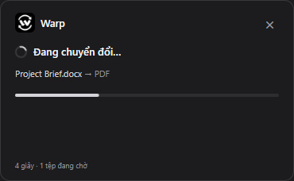

# Warp

Chuyển đổi tài liệu ngay trên Desktop và File Explorer: chọn tệp, giữ **Alt + Shift**, kéo sang định dạng cần dùng. Warp tạo bản sao cạnh tệp gốc.

**Windows x64 · Bản thử nghiệm 0.4.2**

[Tải bộ cài Windows](https://github.com/HuangKha097/Warp/releases/tag/v0.4.2) · [Báo lỗi](https://github.com/HuangKha097/Warp/issues) · [Kiểm thử](docs/testing.md)


*Ảnh minh họa từ ứng dụng thật trên nền Desktop giả lập của bộ kiểm tra giao diện.*

## Cài đặt và sử dụng

1. Tải và chạy **Warp-Setup-0.4.2.exe**. Nếu đang dùng Warp, bấm phải biểu tượng khay hệ thống → **Exit** trước khi cập nhật.
2. Warp chạy trong **khay hệ thống cạnh đồng hồ** và được đăng ký chạy khi đăng nhập Windows. Kiểm tra mục biểu tượng ẩn `^` nếu chưa thấy logo.
3. Bấm một lần chọn tệp trên Desktop hoặc trong Explorer, sau đó **giữ Alt + Shift**. Vòng tròn hiện quanh vị trí tệp; phần tâm trong suốt để nhìn thấy tệp gốc.
4. Vẫn giữ hai phím, nhấn giữ chuột tại tệp, kéo sang một múi định dạng đang bật rồi thả chuột để xác nhận. Nhả Alt hoặc Shift trước khi xác nhận sẽ hủy thao tác.
5. Vòng tròn đóng, bảng tiến trình xuất hiện ở góc phải dưới. Bản chuyển đổi được lưu **cùng thư mục với tệp gốc**; tên trùng sẽ thêm số, ví dụ `Báo cáo (1).pdf`.

Bộ cài đã chứa bộ chuyển đổi. Người dùng **không cần cài LibreOffice, Microsoft Office, Node.js hoặc cơ sở dữ liệu**. Tài liệu được xử lý trên máy, không tải lên dịch vụ đám mây.

## Hoạt động trong nền

- Không có cửa sổ menu khi mở ứng dụng. Bấm biểu tượng khay để xem lại trạng thái chuyển đổi gần nhất; bấm phải → **Exit** để thoát.
- Có thể chọn tệp khác và gọi vòng tròn trong lúc tác vụ trước đang chạy. Các yêu cầu được xếp hàng và xử lý lần lượt.
- Thanh loading cho biết đang chuẩn bị, chuyển đổi hoặc lưu; không hiển thị phần trăm ước lượng. Thành công có **Mở thư mục**, lỗi có lý do và **Thử lại**.
- Bấm `×` để ẩn bảng tiến trình. Tác vụ đã xác nhận vẫn tiếp tục chạy nền.
- Khi tệp sát mép/góc màn hình, vòng tròn dịch vào vùng làm việc, tránh taskbar và giữ nguyên các múi. Nếu không đủ chỗ, vòng tròn cùng icon/nhãn thu nhỏ theo. Có thể bắt đầu kéo từ vị trí tệp gốc hoặc tâm vòng tròn.
- Có thể tắt tự khởi động qua **Startup Apps** của Windows; gỡ Warp sẽ xóa mục khởi động do bộ cài tạo.



## Định dạng hỗ trợ

Chỉ các đích tương thích với tệp đang chọn mới được bật. Warp không tự tổ chức nội dung Word thành bảng tính Excel hay slide PowerPoint.

| Tệp nguồn | Có thể chuyển sang |
| --- | --- |
| DOCX | PDF, TXT, ODT |
| DOC | PDF, TXT, DOCX |
| ODT, RTF | PDF, DOCX, TXT |
| TXT | PDF, DOCX, ODT |
| XLSX | PDF, CSV, ODS |
| XLS | PDF, CSV, XLSX |
| ODS | PDF, CSV, XLSX |
| CSV | PDF, XLSX, ODS |
| PPTX | PDF, ODP |
| PPT | PDF, PPTX, ODP |
| ODP | PDF, PPTX |

Giới hạn hiện tại:

- Chưa hỗ trợ PDF đầu vào/OCR, nhiều tệp cùng lúc, thư mục hoặc tệp đám mây chưa tải xuống máy.
- TXT và CSV có thể mất định dạng. Bố cục đầu ra phụ thuộc font và khả năng nhập/xuất của bộ chuyển đổi.
- Chưa hỗ trợ tài liệu có mật khẩu. Bộ cài chưa ký mã; đây là bản thử nghiệm.
- Alt + Shift có thể đồng thời đổi ngôn ngữ bàn phím trong Windows. Warp không thay đổi thiết lập phím tắt của hệ thống.

## Kiến trúc


[Sơ đồ HTML tương tác](docs/architecture.html) · [Nguồn Archify](docs/architecture.json). Tải HTML về và mở bằng trình duyệt để xem chi tiết và liên kết tới code.

Nội dung sơ đồ bằng tiếng Việt; một số điều khiển nâng cao của trình xem dùng tiếng Anh.

Helper C# quan sát Alt + Shift và đọc tệp đang chọn bằng Shell COM/UI Automation. Electron kiểm tra yêu cầu IPC, quản lý vòng tròn và hàng đợi. Mỗi tác vụ chuyển đổi chạy trên một bản sao tạm với profile riêng; kết quả được chép sang tên mới bằng thao tác không ghi đè. Trạng thái hàng đợi nằm trong bộ nhớ, không khôi phục sau khi thoát ứng dụng. Không có backend server hay database.

## Phát triển

Yêu cầu: **Windows x64**, **Node.js 22.12+** hoặc bản LTS mới tương thích, npm và .NET Framework 4.x. CI sử dụng Node.js 24. Các yêu cầu này dành cho người phát triển; người dùng chỉ cần bộ cài Warp.

```powershell
npm ci
node node_modules/electron/install.js
npm run prepare:engine
npm start
```

`prepare:engine` tải bản LibreOffice đã ghim phiên bản và SHA-256, rồi giải nén vào `vendor/libreoffice`. Đây là bước **build**, không cài LibreOffice vào Windows hoặc đổi liên kết mở tệp. Xem [giấy phép và nguồn bộ chuyển đổi](THIRD-PARTY-NOTICES.md).

Các lệnh chính:

| Lệnh | Chức năng |
| --- | --- |
| `npm start` | Build và chạy Warp trong khay hệ thống |
| `npm run check` | Kiểm tra TypeScript và mã không còn dùng |
| `npm test` | Kiểm tra hàng đợi, giữ/nhả phím, vùng thả và bảo toàn tệp |
| `npm run test:engine` | Chuyển đổi bằng bộ chuyển đổi đi kèm thật |
| `npm run build` | Build renderer, Electron và helper C# |
| `npm run test:visual` | Kiểm tra renderer sau khi build |
| `npm run test:runtime` | Kiểm tra luồng Electron với bộ chuyển đổi thật sau khi build |
| `npm run package -- --publish never` | Tạo bộ cài NSIS trong `release/` |

CI chạy các kiểm tra trên và lưu bộ cài vào artifact **Warp-Windows**. Việc xuất bản GitHub Release là bước riêng của người bảo trì. Bộ cài khoảng 500 MB vì có chứa bộ chuyển đổi; chưa có cập nhật tự động.

## Cấu trúc repository

| Thư mục | Trách nhiệm |
| --- | --- |
| `src/` | Vòng tròn React, hiệu ứng Dock và bảng tiến trình |
| `electron/` | Main process, preload, contract dùng chung, lựa chọn tệp và hàng đợi |
| `native/` | Helper Windows C# đọc phím và tệp đang chọn |
| `scripts/` | Build helper/icon, chuẩn bị bộ chuyển đổi và cấu hình bộ cài |
| `tests/` | Unit/integration test và harness Electron trong `tests/electron/` |
| `docs/` | Hình minh họa, sơ đồ kiến trúc và phạm vi kiểm thử |
| `assets/` | Logo nguồn và các kích thước icon ứng dụng |

`node_modules/`, `vendor/`, `dist/`, `dist-electron/`, `release/`, `.cache/` và `.archify/` là dependency hoặc đầu ra sinh tự động, không đưa vào Git. Ảnh/biên nhận kiểm tra được lưu trong `.cache/`, không xuất ra ngoài repository.

## Khắc phục sự cố

- **Không thấy biểu tượng Warp:** kiểm tra khay biểu tượng ẩn và chạy lại ứng dụng. Warp chỉ cho phép một phiên chạy.
- **Không đọc được tệp đang chọn:** chọn đúng một tệp đã có trên ổ đĩa, nhả rồi giữ lại Alt + Shift. Các bố cục Explorer/DPI khác nhau cần kiểm tra thực tế; xem [phạm vi kiểm thử](docs/testing.md).
- **Chuyển đổi thất bại:** xem lý do trên bảng tiến trình, kiểm tra quyền ghi và dung lượng thư mục đích, rồi chọn **Thử lại**. Nếu báo thiếu bộ chuyển đổi tích hợp, cài lại bộ cài đầy đủ.

Log chẩn đoán nằm ở `%APPDATA%\Warp\runtime.log`, ghi các mốc khởi động/helper/vòng tròn; không ghi tên tệp từ những sự kiện này. Khi báo lỗi, gửi phiên bản Warp, bản Windows, định dạng nguồn/đích và thông báo lỗi; tránh gửi tài liệu nhạy cảm.

## Giấy phép

Mã ứng dụng theo [MIT](LICENSE). Logo là artwork do người dùng cung cấp. Bộ chuyển đổi và các thành phần bên thứ ba có giấy phép riêng: [THIRD-PARTY-NOTICES.md](THIRD-PARTY-NOTICES.md).
