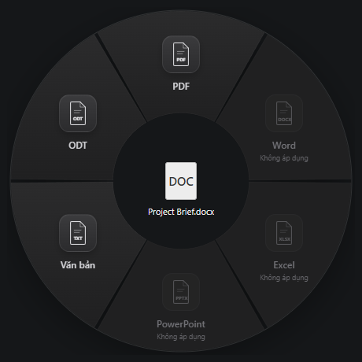

# Warp

**Windows MVP · v0.4.1 (prerelease)**

[Download Windows installer](https://github.com/HuangKha097/Warp/releases/tag/v0.4.1) · [Hướng dẫn sử dụng](HUONG-DAN.md)



Windows file conversion from a transparent radial menu. Select a file in Explorer/Desktop, hold **Alt + Shift**, drag the selected file toward a format slice, and release the mouse to confirm. Releasing either modifier hides the layer and cancels an unfinished gesture.

## Install and use

1. Download and run `Warp-Setup-0.4.1.exe`. The installer includes the local conversion engine. **Users do not need to download or install LibreOffice, Microsoft Office, Node.js or any other conversion tool.**
2. Warp starts silently in the system tray and is registered to run when you sign into Windows. No main/menu window opens. Single-click a document in Explorer or on the Desktop.
3. Hold Alt + Shift. A single circular ring with contiguous format slices appears around the selection. Its center is visually empty so the actual file on the Desktop/Explorer stays visible.
4. Keep the modifiers held, press the file icon, drag onto an enabled slice, and release the mouse. Then release the keys to dismiss the ring.
5. The converted copy is written beside the original. Existing files are preserved using numbered names. Confirmed conversions continue in the background after the ring disappears.

Unsupported destinations remain visible as disabled slices. Warp does not restructure a Word document into a spreadsheet or presentation. At screen edges the full circle moves inward just enough to fit; an additional clear area keeps the original icon visible. Dragging can start from that icon or the empty center.

A small bottom-right progress card shows preparation, conversion, saving, elapsed time and queued files. Its loading bar is indeterminate while processing. Completed copies can be revealed in their folder; failures include a reason and Retry. You can select another file while a conversion runs; jobs are serialized independently of the current selection. Click the tray icon to reopen the latest status. Right-click the tray → Exit to stop Warp. The installer registers a per-user Windows startup entry and removes it on uninstall. Alt + Shift can also trigger Windows input-language switching; Warp observes this shortcut without changing Windows settings.

## Supported sources and destinations

| Source | Targets |
|---|---|
| DOCX | PDF, TXT, ODT |
| DOC | PDF, TXT, DOCX |
| ODT, RTF | PDF, DOCX, TXT |
| TXT | PDF, DOCX, ODT |
| XLSX | PDF, CSV, ODS |
| XLS | PDF, CSV, XLSX |
| ODS, CSV | PDF and compatible spreadsheet formats |
| PPTX | PDF, ODP |
| PPT | PDF, PPTX, ODP |
| ODP | PDF, PPTX |

PDF input/OCR, multiple file selection, directories and cloud-only placeholders are not supported. TXT/CSV are lossy formats. Layout depends on available fonts and the bundled engine's import/export support. Password-protected documents are not supported.

## Local processing

No account, backend server, database or cloud uploads are used. The bundled engine runs headlessly on a temporary snapshot of the input with an isolated profile per conversion. The app writes output copies with exclusive creation, so it never overwrites a pre-existing destination.

## Develop and build

Windows x64, Node.js 22.12+ or a compatible newer LTS, npm and .NET Framework 4.x are needed for development. End users only need the complete Warp installer.

```powershell
npm ci
node node_modules/electron/install.js
npm run prepare:engine
npm run check
npm test
npm run test:engine
npm run build
npm run test:visual
npm run test:runtime
npm start
```

`prepare:engine` is a **build-time** step: downloads the pinned official LibreOffice Windows MSI, verifies SHA-256 and extracts an administrative image into `vendor/libreoffice`. It does not install LibreOffice into Windows or change file associations. The full unmodified runtime and its notices are included in the final installer. Build cache and engine binaries are ignored by Git.

```powershell
npm run package
```

This creates a per-user Windows installer in `release/`. The download is larger because the conversion engine is included. Builds are unsigned; code signing and automatic updates are not configured. GitHub CI builds and uploads an installer artifact; publishing a GitHub Release remains a maintainer action.

## Architecture

- `src/`: React/TypeScript, annular SVG slices with matching hit testing, an empty center with an invisible drag handle, and a drag ghost.
- `electron/main.ts`: tray-only startup, transparent hold-only layer, non-activating progress card, validated IPC and conversion queue.
- `electron/hold.ts`: gesture generation gate rejects stale selection lookups after modifier release.
- `electron/conversion.ts`: bundled-engine discovery, format allowlist, isolated conversion, safe output naming.
- `native/SelectionWatcher.cs`: observes Alt + Shift, reads foreground Explorer selection through Shell COM and icon coordinates through UI Automation. Selection capture runs on an STA worker so the key-release loop remains responsive.
- `scripts/prepare-engine.ps1`: reproducible pinned engine packaging.

The helper never simulates Ctrl+C and never reads the clipboard. Icon positions are estimated from UI Automation bounds; Explorer tabs, unusual layouts, DPI and multi-monitor combinations need manual acceptance checks. See `VALIDATION.md` for verification limits.

## License

Application code: MIT. The user-supplied Warp logo is separate artwork. Bundled engine: upstream licenses; see `THIRD-PARTY-NOTICES.md` and the original license files in the engine resources.

## Interface

Monochrome circular Dock: charcoal surfaces, thin neutral borders and document glyphs. The center shows the original file underneath without drawing another icon, label or panel. Icons magnify smoothly with pointer proximity, neighboring enabled icons respond with a cosine falloff, and an idle spring returns them to rest. Confirmed actions have a small bounce. The orbit enters with a short scale/fade on each hold; key release hides it immediately. Reduced-motion preferences disable magnification and bounce. There is no companion/menu window; the ring appears only while the shortcut is held. This is a circular adaptation of the React Bits Dock reference supplied by the user, with no new Dock package dependency. The updated, cropped user logo replaces the prior artwork in all icon sizes.
