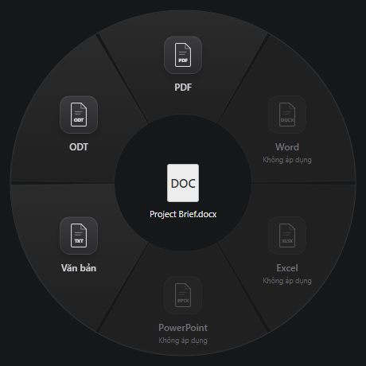

  

<h1 align="center">Warp</h1>

Chuyển đổi tài liệu ngay trên Desktop và File Explorer.

  <a href="https://github.com/HuangKha097/Warp/releases"><strong>Tải cho Windows</strong></a>
  &nbsp;·&nbsp;
  <a href="https://github.com/HuangKha097/Warp/issues">Báo lỗi</a>

Windows x64 · Tauri + React · Mã nguồn 0.6.0

  

Warp mở một vòng tròn định dạng quanh tệp đang chọn khi bạn giữ **Alt + Shift**. Kéo sang định dạng cần dùng để tạo bản chuyển đổi. Mặc định bản sao nằm cùng thư mục với tệp gốc.

- **Xử lý trên máy** — tài liệu không được tải lên dịch vụ đám mây.
- **Giữ nguyên bản gốc** — tạo tệp mới, tự thêm số khi tên đã tồn tại.
- **Sẵn sàng trong nền** — chạy từ khay hệ thống, có tiến trình và hàng đợi chuyển đổi.

## Cài đặt

Tải bộ cài Windows tại [Releases](https://github.com/HuangKha097/Warp/releases) và chạy bộ cài. Bộ chuyển đổi đã được tích hợp, không cần cài LibreOffice hoặc Microsoft Office riêng. Mã nguồn 0.6 chuyển từ Electron sang Tauri; việc đổi mã nguồn không tự xuất bản bộ cài mới lên Releases.

Từ phiên bản 0.5, bộ cài cho phép chọn ngôn ngữ, yêu cầu đồng ý [giấy phép MIT](LICENSE), có link xem giấy phép trên GitHub và cho chọn thư mục cài ứng dụng. Lần chạy đầu hiển thị hướng dẫn minh họa ba bước; hoàn tất hoặc bỏ qua để Warp về khay hệ thống.

Nếu đang dùng Warp, chọn **Exit** từ biểu tượng khay trước khi cập nhật. Warp mặc định chạy cùng Windows; có thể tắt trong **Cài đặt** hoặc **Startup Apps** của Windows. Cập nhật không bật lại lựa chọn khởi động đã tắt.

## Sử dụng

1. Bấm một lần để chọn một tệp trên Desktop hoặc trong File Explorer.
2. Giữ **Alt + Shift** để hiện vòng tròn.
3. Nhấn giữ chuột trên tệp, kéo sang một định dạng đang bật rồi thả chuột.
4. Theo dõi tiến trình ở góc phải dưới. Khi hoàn tất, chọn **Mở thư mục** để xem kết quả.

Nhả Alt hoặc Shift trước khi xác nhận để hủy thao tác. Các tác vụ đã xác nhận tiếp tục chạy nền; bạn có thể chọn tệp khác để chuyển đổi tiếp. Nếu có lỗi, thông báo hiển thị lý do và tùy chọn **Thử lại** cho tác vụ chuyển đổi.

Bấm biểu tượng khay để xem lại tiến trình gần nhất. Bấm phải để mở **Cài đặt**, xem lại **Hướng dẫn sử dụng** hoặc **Exit** để thoát.

## Tùy chọn

| Mục | Hành vi |
| :--- | :--- |
| Nơi lưu bản chuyển đổi | Mặc định **Ở thư mục cùng file gốc**: nguồn ở Desktop thì bản sao cũng ở Desktop. Có thể chọn thư mục riêng. |
| Ngôn ngữ | Tiếng Việt hoặc English, áp dụng ngay cho hướng dẫn, Settings, khay hệ thống, vòng tròn và thông báo. |
| Chạy cùng Windows | Bật/tắt trong bản Warp đã cài đặt; khi đăng nhập lại, app chạy nền. |
| Thư mục cài Warp | Chọn trong bộ cài; Settings hiển thị vị trí thực tế và nút mở. |
| File lưu tùy chọn | `%APPDATA%\Warp\settings.json`, chỉ lưu cục bộ theo tài khoản Windows. |

Thay đổi được lưu ngay. Tác vụ đã xác nhận giữ nguyên thư mục đích trước đó. Warp luôn giữ bản gốc và tránh ghi đè tệp đã có, kể cả trong thư mục riêng.

## Định dạng hỗ trợ

Chỉ các định dạng tương thích với tệp đang chọn mới được bật.

| Tệp nguồn | Định dạng đầu ra |
| :--- | :--- |
| DOCX | PDF, TXT, ODT |
| DOC | PDF, TXT, DOCX |
| ODT, RTF | PDF, DOCX, TXT |
| TXT | PDF, DOCX, ODT |
| XLSX | PDF, CSV, ODS |
| XLS | PDF, CSV, XLSX |
| ODS | PDF, CSV, XLSX |
| CSV | PDF, XLSX, ODS |
| PPTX | PDF, ODP |
| PPT | PDF, PPTX, ODP |
| ODP | PDF, PPTX |

Hiện chưa hỗ trợ PDF đầu vào/OCR, nhiều tệp cùng lúc, thư mục, tài liệu có mật khẩu hoặc tệp đám mây chưa tải về máy. TXT/CSV có thể mất định dạng; bố cục đầu ra phụ thuộc font và tài liệu nguồn. Bộ cài hiện chưa ký mã. Alt + Shift có thể đồng thời đổi ngôn ngữ bàn phím theo thiết lập Windows.

## Kiến trúc

React hiển thị vòng tròn và thông báo trong WebView2 của Windows. Tauri/Rust quản lý cửa sổ, khay hệ thống, hàng đợi, cài đặt và bộ chuyển đổi cục bộ; helper C# đọc lựa chọn từ Windows Shell. Bản phân phối không đóng gói Chromium hoặc Node.js riêng. Mỗi tác vụ dùng bản sao tạm và profile riêng. Ứng dụng không cần backend server hoặc database.

LibreOffice vẫn được đóng gói đầy đủ để sử dụng offline sau cài đặt, nên đây vẫn là phần chiếm nhiều dung lượng. WebView2 dùng runtime chung; nếu thiếu, bộ cài cần mạng để tải runtime Microsoft. RAM, độ trễ Alt + Shift và dung lượng bản mới cần được đo trên bản build thực tế; không suy ra từ việc đổi framework.

## Phát triển

Xem [hướng dẫn phát triển và build](docs/development.md) và [phạm vi kiểm thử](docs/testing.md).

## Giấy phép

Mã ứng dụng theo [MIT](LICENSE). Logo và các thành phần đi kèm được mô tả trong [thông tin giấy phép](THIRD-PARTY-NOTICES.md).
